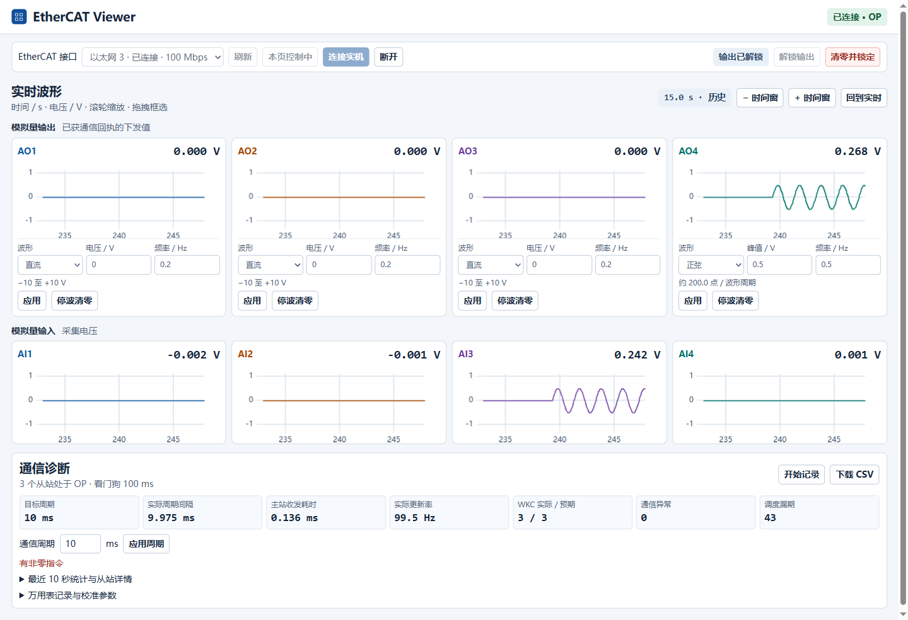

# EtherCAT Viewer

在 Windows 上连接 Beckhoff EK1100、EL3104 和 EL4134，显示四路模拟量输入、四路输出、波形发生器与通信诊断。仪表盘运行在本机浏览器中。



*实机演示。AO4 输出正弦波，AI3 显示交叉回环的采集结果。*

## 一、下载 EXE 启动

从 [GitHub Releases](https://github.com/llbk-kevin/EtherCAT-Viewer/releases/latest) 下载 Windows x64 单文件 EXE。双击运行，控制台提示服务就绪后自动打开 [仪表盘](http://127.0.0.1:8765/)。运行 EXE 无需安装 Git 或 Python。连接实机要先安装 [Npcap](https://npcap.com/#download)，勾选 **Install Npcap in WinPcap API-compatible Mode**。

## 二、从源码启动

安装 [Git for Windows](https://git-scm.com/download/win) 和 [Python 3.12 x64](https://www.python.org/downloads/windows/)，确保 `python.exe` 在 PATH 中。如需访问受限仓库，用已获权限的 GitHub 账号完成 Git Credential Manager 登录。克隆后双击 `start-viewer.cmd`，首次启动会安装 Python 依赖。

```powershell
git clone https://github.com/llbk-kevin/EtherCAT-Viewer.git
cd EtherCAT-Viewer
```

## 三、连接 EtherCAT 实机

用专用有线网卡直连已供电的 EK1100 **X1**，确认终端排列为 **EK1100 → EL3104 → EL4134 → EL9011**。在网页选择该网卡，点「取得控制权」和「连接实机」。首次连接保持输出锁定，确认状态为 OP、WKC 为 `3/3` 后再做回环实验。停止前从网页清零并断开，随后在后端控制台按 **Ctrl+C**。

## 四、文档

1. [Windows 安装与首次启动](docs/01-安装与首次启动.md)
2. [实机接线与仪表盘操作](docs/02-实机接线与仪表盘操作.md)
3. [系统架构与实现细节](docs/03-系统架构与实现细节.md)
4. [通信诊断与故障排查](docs/04-通信诊断与故障排查.md)
5. [现场现状与验收记录](docs/05-现场现状与验收记录.md)
6. [开发、打包与发布](docs/06-开发、打包与发布.md)

第三方依赖的许可与对应源码见 [第三方组件与许可](THIRD-PARTY-NOTICES.md)。
