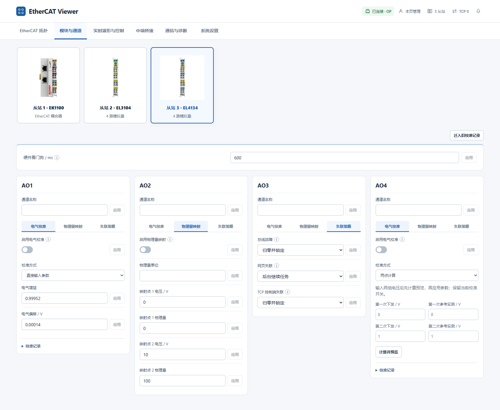
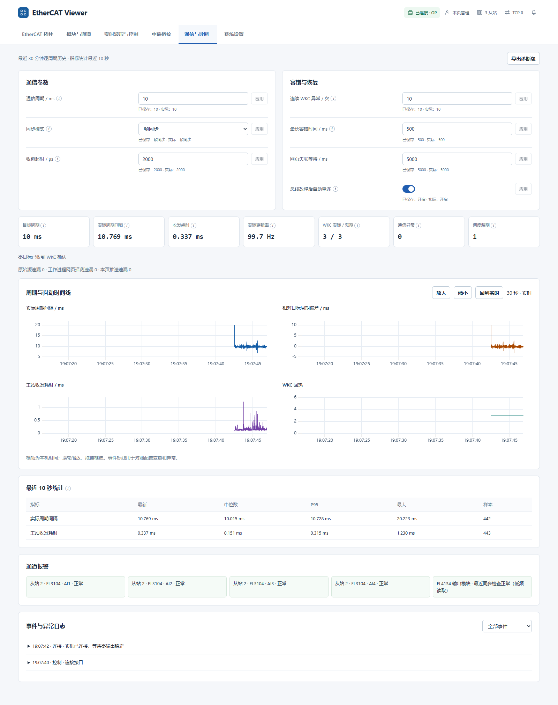

# EtherCAT Viewer

在 Windows 上连接 Beckhoff EK1100、EL3104 和 EL4134，支持多片输入输出模块、波形发生器、通信诊断，以及中瑞采集卡 TCP 协议桥接。仪表盘运行在本机浏览器中。



*六个主页面分别负责拓扑、模块与通道、波形控制、桥接、通信诊断和系统设置。点击产品图片选择从站，四张通道卡各自切换校准、物理量映射及 AO 失联策略。*

## 一、下载 EXE 启动

从 [GitHub Releases](https://github.com/llbk-kevin/EtherCAT-Viewer/releases/latest) 下载 Windows x64 单文件 EXE。双击运行，控制台提示服务就绪后自动打开 [仪表盘](http://127.0.0.1:8765/)。运行 EXE 无需安装 Git 或 Python。连接实机要先安装 [Npcap](https://npcap.com/#download)，勾选 **Install Npcap in WinPcap API-compatible Mode**。

## 二、从源码启动

安装 [Git for Windows](https://git-scm.com/download/win) 和 [Python 3.12 x64](https://www.python.org/downloads/windows/)，确保 `python.exe` 在 PATH 中。如需访问受限仓库，用已获权限的 GitHub 账号完成 Git Credential Manager 登录。克隆后双击 `start-viewer.cmd`，首次启动会安装 Python 依赖。

```powershell
git clone https://github.com/llbk-kevin/EtherCAT-Viewer.git
cd EtherCAT-Viewer
```

## 三、连接 EtherCAT 实机

用专用有线网卡直连已供电的 EK1100 **X1**，当前台架为 **EK1100 → EL3104 → EL4134 → EL9011**，也支持多片同型号 IO。在「EtherCAT 拓扑」页选择该网卡，再点击“连接”搜索并连接；刷新网页恢复当前连接。首次连接保持输出锁定，确认状态为 OP、WKC 实际值与预期值一致（当前台架为 `3/3`） 后再做回环实验。在控制页按通道允许网页控制，或在桥接页授权 TCP。停止可按控制台 **Ctrl+C** 或关闭窗口；按 **O** 可随时打开管理页。

## 四、中瑞协议桥接

在网页配置原版 8 AI/2 AO 虚拟卡或可变通道的扩展卡，公司软件连接对应 TCP 地址与端口。支持混合类型虚拟卡、逐通道读写权限、电气校准和首次配置后的无人值守启动。支持任意波形和可选的 0–3.3 V → ±10 V 输出映射；逻辑补点速率与真实采样能力分别显示。操作、协议和限制见 [中瑞协议桥接与兼容说明](docs/07-中瑞协议桥接与兼容说明.md)。该功能使用本分支源码或 v0.2.0 及以后构建，v0.1.0 EXE 不包含。


*列表右侧 ＋ 创建原版卡，卡内可改扩展协议；启动选项逐卡设置，管理身份与输出授权分别管理。*



*诊断图同时展示目标周期、实际周期与异常；1 ms 为可选目标，实际表现以时间线和实测统计为准。*

## 五、文档

1. [Windows 安装与首次启动](docs/01-安装与首次启动.md)
2. [实机接线与仪表盘操作](docs/02-实机接线与仪表盘操作.md)
3. [系统架构与实现细节](docs/03-系统架构与实现细节.md)
4. [通信诊断与故障排查](docs/04-通信诊断与故障排查.md)
5. [现场现状与验收记录](docs/05-现场现状与验收记录.md)
6. [开发、打包与发布](docs/06-开发、打包与发布.md)：项目目录与文件职责、目录与文件新增规则、开发规范，以及测试、打包和发布流程。
7. [中瑞协议桥接与兼容说明](docs/07-中瑞协议桥接与兼容说明.md)

第三方依赖的许可与对应源码见 [第三方组件与许可](THIRD-PARTY-NOTICES.md)。

## 六、外部参考资料

- [中瑞 E1682 TCP/IP 通信协议](reference/中瑞E1682-TCP-IP通信协议.md)
