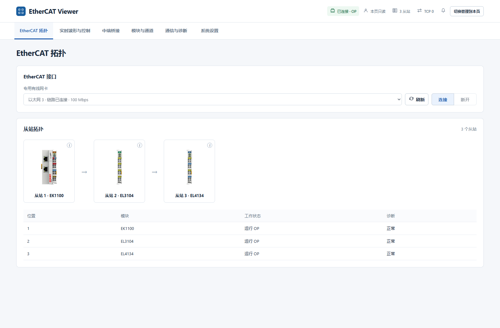

# 二、实机接线与仪表盘操作

## 一、端子排列、供电与网线

从左到右安装 **EK1100 → EL3104 → EL4134 → EL9011**。前三件是可扫描的 EtherCAT 从站，EL9011 是末端盖。使用专用物理有线网卡和 CAT5 或更高规格网线直连 EK1100 的 X1 IN。当前单链路接法将 X2 OUT 留空，X1 协商速率应为 100 Mbps。

EK1100 上方标记 24 V/0 V 的 **Us** 为耦合器供电，并经 E-bus 为两个模拟量模块供电。新环境使用标称 24 V DC，在端子处核对电压和极性。Us 允许范围为 20.4–28.8 V。下方 **Up** 向现场电源触点供电，这两个模拟量模块经 E-bus 取电。增加其他端子时按其手册核算供电和负载。[EK1100 技术数据](https://infosys.beckhoff.com/content/1033/ek110x_ek15xx/7636174091.html) · [电源与电位组](https://infosys.beckhoff.com/content/1033/ek110x_ek15xx/1880428299.html)

## 二、模拟量端口和测量

两片模块均为四路 ±10 V。下表的数字是面板物理端子号，按设备标签核对。

| 通道 | EL4134 输出 / GND | EL3104 正输入 / 负输入 |
| --- | --- | --- |
| 1 | 1 / 2 | 1 / 2 |
| 2 | 5 / 6 | 5 / 6 |
| 3 | 3 / 4 | 3 / 4 |
| 4 | 7 / 8 | 7 / 8 |

回环用两根线：AO 输出接目标 AI 正端，配对 GND 接目标 AI 负端。第一次可用 AO1 的 1/2 → AI1 的 1/2。历史现场确认的交叉回环为 **AO4 的 7/8 → AI3 的 3/4**。万用表置直流电压档，红笔接对应 AO 输出，黑笔接其配对 GND。避免把模拟量端子接到 EK1100 电源端或接触其他输出。改线前清零并锁定，操作电源接线前断电。[EL4134 连接与 LED](https://infosys.beckhoff.com/content/1033/el41xx/13207030411.html) · [EL3104 连接与 LED](https://infosys.beckhoff.com/content/1033/el31xx/12044928907.html)

## 三、六个功能页面与首次连接

1. 在「EtherCAT 拓扑」选择实际接至 X1 的专用有线网卡，再点击分段控件的“连接”。选择本身不搜索或连接，刷新仅更新接口列表。右上状态区集中显示总线、网页管理身份、从站数和 TCP 连接数；操作结果进入固定通知区。
2. 检查拓扑和从站状态。当前三从站预期 WKC 为 3，其他模块组合由实际映射计算，不能一律按 3 判断。
3. 在「实时波形与控制」查看实际通道。每个 AO 显示“锁定”“网页控制”或具体虚拟卡名称；点击目标通道的“允许网页控制”后，才可下发小幅直流或波形。
4. 在「中瑞桥接」逐卡添加原版或扩展设备、映射并指定只读/可写通道。AI 可重复映射；同一真实 AO 只能配置一个启用的 TCP 写入映射。TCP 授权只转交本卡的可写通道，网页仍能控制空闲 AO。
5. 刷新页面恢复当前管理身份、接口和后端输出任务。其他页面默认只读，可明确“切换管理到本页”；管理页面身份不等于 AO 写权限。
6. 换线前“全部清零并锁定”；结束时在配置页断开接口，再到控制台按 Ctrl+C 或点击 ×。全局清零会停止桥接发布并阻止自动重新授权覆盖这次人工锁定。

2026-11-23 用户重新确认并在本轮验证的是 **AO1 的 1/2 → AI1 的 1/2**。上文 AO4→AI3 是先前现场接法，其他通道是否仍有回环需现场核对，不能据历史记录推定。

## 四、波形、图表和数据

每路 AO 支持直流、正弦、三角与 50% 占空比方波。直流目标 −10 至 +10 V；周期波形以 0 V 为中心，峰值最大 10 V，频率从 0.01 Hz 起，默认 0.2 Hz。频率上限为 min(100, 250/目标周期毫秒) Hz。每周期少于 20 个实际更新点时提示台阶。

当前硬件显示上排四 AO、下排四 AI；更多同型号模块按实际通道动态生成，可按模块筛选。滚轮围绕指针位置缩放、拖拽框选，或使用缩放按钮；回到实时恢复最近 30 秒。切换主页面不重建总线、不清空波形缓存。AO 曲线是获 WKC 回执的量化下发目标，不是端子独立测量值；AI 曲线是校准后的采集电压。异常数据在曲线上留空。

记录入口位于「实时波形与控制」。开始记录后可在其他页面继续操作，停止后下载 CSV。四入四出时为 39 列，包含原始 AI、校准电压、有效性、通道状态、AO 回执目标、主机发送/返回时间、周期和 AI/AO 工程量。工程量未启用时对应列为空。

## 五、电气校准与物理量映射

「模块与通道」先按真实从站选择模块，再展开其通道。EL3104 的输入滤波按整片模块设置，EL4134 的看门狗也按整片设置；三类失联策略与电气校准、物理量映射按真实通道保存。AI：校准电压=增益×原始换算电压+偏移；AO：目标物理电压经同一关系反算为 DAC 指令。校准对网页、TCP 和 CSV 统一生效。可填写两次原始/指令电压和参考实测值计算参数，也可直接编辑增益与偏移。AI 电气参数可在线应用；AO 电气参数需点击“清零并重连应用”。两点计算先预览增益与偏移，再一次应用参数和测量记录，保留原校准开关；请用独立参考读数建立参数。

两点物理量映射独立启用，例如 0 V↔0 MPa、5 V↔100 MPa。网页可显示 MPa，AO 直流可按 MPa 输入并反算电压。原版 TCP 始终按电压解释；扩展数据附带工程量和单位元数据。两点的电压及物理量均需不同，输出最终仍受 ±10 V 和校准后可达范围限制。

旧浏览器万用表记录可迁入后端的测量记录，迁移不自动启用先前没有参与计算的校准。人工清零的含义始终是物理目标 0 V，经已验证的电气校准换算；不经过中瑞码值映射或工程量换算。

## 六、同步、故障与无人值守

「通信与诊断」是唯一通信周期入口，并提供保留当前模式、自由运行、帧同步和 DC、收包超时与软件容错。输入滤波位于「模块与通道」，按 EL3104 整片配置。模式与滤波必须符合能力回读，帧同步/DC 关闭输入滤波。DC 修改周期使用“清零并重连应用”；主机实际表现查看诊断页。切换同步不会自动恢复旧波形。

默认 WKC 连续 10 次或 500 ms 超限才进入故障策略，硬件看门狗为 600 ms。容错期间冻结最后确认目标，暂停采集数据；恢复后继续。网页关闭默认后台继续任务，也可改为等待后保持、归零或指定电压。总线和 TCP 失联策略另按真实 AO 配置，详见 [通信诊断](04-通信诊断与故障排查.md)。

「系统设置」配置是否打开浏览器、控制台最小化、当前用户登录启动和配置文件导入导出；启动开关拨动即保存。固定网卡自动连接位于桥接页，监听和 TCP 写入按卡配置；自动重连位于通信与诊断。无人值守先确认零输出，之后接受新指令；不重放上次非零输出。控制台随时可按 O 用默认浏览器打开本机管理页。

## 七、逐项应用、草稿与提示

每个参数各有应用入口。文字或数字输入后立即形成草稿，失焦、切换功能页和状态推送不会将其改回后台值；点应用只提交该字段及页面已列出的必要关联项。字段下面区分“已保存”“实际”和“未应用草稿”。设备未知或读取失败时不会把保存值冒充实际值。

- 周期、收包超时和软件容错等可在线调整的参数直接应用。同值且实际状态一致时不增加配置修订。
- 同步、输入滤波、模块看门狗、AO 校准和硬件替代行为使用“清零并重连应用”。页面先显示关联变化及任务影响；点击即停止发布、确认全路零目标、重配并重连。完成后保持锁定，不重放波形或自动重新授权。
- 例如选择 DC 会同时关闭整片 EL3104 滤波；延长容错窗口可能需要增加 EL4134 看门狗。页面列出这些变化，其他未提交草稿继续保留。
- 其他页面更新了无关字段时可合并；同一字段更新时保留本地草稿并提示冲突，可“使用后台值”或“保留草稿并重新核对”。失败时草稿保留，修正输入或点击“重试”。
- 启动开关拨动即保存，下次启动生效。桥接卡的监听及 TCP 写入选项只影响对应稳定 ID 的卡。卡标签支持左右方向键、Home/End 和键盘聚焦；刷新保留所选卡。
- 参数与模块说明使用 i 按钮，支持悬停、聚焦和点击。右上持续状态与操作通知分别管理，通知可关闭，也可从铃铛查看近期记录。

系统设置显示真实配置文件路径，可复制或打开固定配置目录。导入前先预览，执行会清零断开；导入后仍需手动核对网卡。配置不是热加载文件，直接编辑磁盘文件后需重启或通过导入应用。
